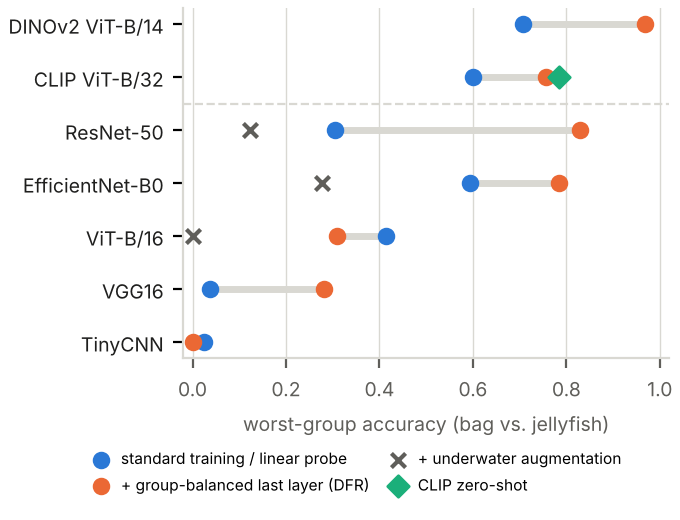
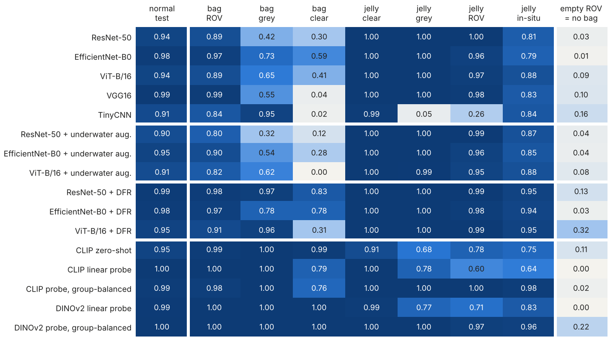

# Bag or Background?

**Diagnosing and mitigating source shortcuts in underwater plastic-bag vs. jellyfish classification**

[](https://namratadatta04.github.io/jellyfish-image-classification/)


[](LICENSE)

Sea turtles swallow plastic bags because they look like jellyfish. An underwater camera that tells the two apart
could guide debris clean-up without harming wildlife. Modern networks score **89–98% macro-F1** on this task.
This project shows that much of that score is a **shortcut**: in every public dataset we could combine, bags were
filmed by deep-sea robots and jellyfish were photographed in clear water, so a network can recognise the
*background* instead of the object. We measure the shortcut, explain why an obvious fix fails, and repair most of it.

### ▶ [Try the model in your browser](https://namratadatta04.github.io/jellyfish-image-classification/)

Upload an underwater photo, or click an *empty* background, and compare a normally fine-tuned network with the
same network after the shortcut fix. The model runs on your device; no image is uploaded anywhere.

## Key findings

| | Result |
| --- | --- |
| Data leakage found | The popular Kaggle jellyfish set has only **369 unique photos among 979 files**; the official TrashCan split shares **113 of 115** validation videos with training |
| Hidden failure | Pretrained networks with 89–98% test macro-F1 reach only **0.04–0.59 worst-group accuracy** on a class × background benchmark |
| Background alone | With the bag removed, the empty robot-video background is still called “plastic bag” in **90–99%** of cases |
| Negative result | Physics-inspired underwater augmentation makes the shortcut **worse** (worst-group 0.00–0.28); a low-level cue test explains why |
| Fix | Retraining only the last layer on a small group-balanced set (DFR) lifts ResNet-50 worst-group accuracy from **0.30 to 0.83** (mean of 3 seeds) with no loss of test accuracy; significant for **35 of 41** networks (Holm-corrected McNemar) |
| Most robust model | A group-balanced probe on frozen **DINOv2** features: **0.97** worst-group accuracy |



*Worst-group accuracy (bag vs. jellyfish) for each model: standard training (blue), with underwater augmentation
(×) and with the group-balanced last layer, DFR (orange).*



*Accuracy per group of the class × background benchmark. Columns: normal test set, bags on robot-video / grey /
clear-water backgrounds, jellyfish on clear / grey / robot-video backgrounds, real robot-filmed jellyfish from
FathomNet, and how often an empty robot-video background is correctly left unlabelled.*

## What was done

1. **Leakage-controlled data.** Near-duplicate grouping (perceptual hash), removal of TrashCan text bands and
   near-identical frames, and 60/20/20 splits by duplicate group, video and dive.
2. **Broad comparison, 12 methods, 2 tasks, 3 seeds.** From a majority baseline and a “bluer = jellyfish” rule,
   through HOG / colour features with SVMs, a CNN trained from scratch, VGG16, ResNet-50, EfficientNet-B0 and
   ViT-B/16 (fine-tuned), to CLIP (zero-shot and probe) and DINOv2 (probe). Binary task and a 7-class task
   (bag + 6 jellyfish species).
3. **Class × background benchmark**, in the spirit of Waterbirds and ImageNet-9: bags pasted on clear water,
   jellyfish pasted on real robot-video backgrounds, object-free backgrounds, and 138 robot-filmed jellyfish from
   FathomNet.
4. **Fixes.** Underwater-domain augmentation (fails), last-layer retraining (DFR) and group-balanced probes on
   frozen foundation models (work).
5. **Careful evaluation.** Worst-group accuracy, cluster-bootstrap confidence intervals, Holm-corrected McNemar
   tests, calibration (ECE), unseen-object rejection (MSP, energy, k-NN), Grad-CAM and a cost analysis for a
   clean-up robot.

[`docs/PROCESS.md`](docs/PROCESS.md) explains every step in plain English.

## Repository layout

```
common.py               shared settings, data selection, imbalance tools, models, metrics
prepare_data.py         step 1  cleaning, TrashCan bag crops, leak-free split, test sets, class balance
baseline_hog.py         step 2  majority, colour rule, raw pixels, HOG, colour (+ SMOTE / undersampling)
train.py                step 3  train one deep model (architecture, augmentation, bag source, imbalance method)
clip_eval.py            step 4  CLIP zero-shot + linear probe
robustness.py           step 5  cross-dataset, underwater, brightness, noise, FGSM, background swap, unseen objects
gradcam.py              step 6  Grad-CAM heat maps + "does the model look at the bag?" scores
summarize.py            step 7  tables, figures, McNemar tests
run_all.py              runs steps 1-7 in order (resumable)
fathomnet_download.py   downloads robot-filmed jellyfish from FathomNet (crops + dive-level split)
group_benchmark.py      class x background benchmark + low-level cue test
dfr.py                  re-scores every model on the benchmark + last-layer retraining (DFR)
foundation_probe.py     CLIP / DINOv2 zero-shot, linear and group-balanced probes
insitu_experiment.py    same-camera experiment with FathomNet jellyfish
stats.py                worst-group tables, bootstrap CIs, Holm-McNemar, OOD, cost analysis
report_assets.py        LaTeX tables, number macros and figures from the stored results
extra_common.py         helpers for the shortcut-study scripts
*.ipynb                 the same pipeline as Jupyter / Colab notebooks
dataset_preparation_v1/ first data-preparation code (kept as a record)
results_snapshot/       result files of the full runs (tables, figures, per-group numbers)
demo/                   builds the browser demo model from a trained checkpoint
docs/                   live demo (GitHub Pages) and PROCESS.md
```

## Reproduce

Python 3.9+ and an NVIDIA GPU (the full runs used an RTX 4050 Laptop GPU, 6 GB; about 15 GPU hours in total).

```bash
pip install -r requirements.txt
pip install fathomnet                      # only for the optional FathomNet step
```

**Data.** The datasets are not redistributed. Download each into a `Task/` folder next to this repository
(or set `DATA_ROOT`); results go to `outputs/` (or set `OUT_DIR`).

| Folder in `Task/` | Dataset |
| --- | --- |
| `archive_jelly/` | [Jellyfish Image Dataset](https://www.kaggle.com/datasets/anshtanwar/jellyfish-types) (A. Tanwar, Kaggle) |
| `archive_Plastic/` | [Plastic – Paper – Garbage Bag Synthetic Images](https://www.kaggle.com/datasets/vencerlanz09/plastic-paper-garbage-bag-synthetic-images) (Kaggle) |
| `archive_trashcan/` | [TrashCan 1.0](https://conservancy.umn.edu/handle/11299/214865) (Hong, Fulton & Sattar, University of Minnesota; [Kaggle copy](https://www.kaggle.com/datasets/mexwell/trashcan-1-0)) |
| `archive_fathomnet/` | created by `python fathomnet_download.py` from [FathomNet](https://fathomnet.org) (MBARI, CC BY-NC-ND 4.0) |

**Run** (each script skips finished work, so a crashed run can simply be restarted):

| Step | Command | Time (RTX 4050) |
| --- | --- | --- |
| 1 | `python prepare_data.py` | 1 min |
| 2 | `python run_all.py --stages classic clip lrsweep` | 1.2 h |
| 3 | `python run_all.py --stages main underwater --seeds 813 814 815` | 7 h |
| 4 | `python run_all.py --stages imbalance crossdata ablation datasize --seeds 813` | 3 h |
| 5 | `python run_all.py --stages gradcam summary` | 15 min |
| 6 | `python fathomnet_download.py` then `python group_benchmark.py` | 35 min |
| 7 | re-train seeds 814 / 815 of ResNet-50, EfficientNet-B0 and ViT-B/16 with `train.py --seed` (`run_all.py` deletes those checkpoints to save disk, but `dfr.py` needs them) | 2.5 h |
| 8 | `python dfr.py`, `python foundation_probe.py`, `python insitu_experiment.py` | 1.5 h |
| 9 | `python stats.py`, then `python run_all.py --stages summary`, then `python report_assets.py` | 20 min |

Quick checks without the full training time:

```bash
python train.py --task binary --model resnet50 --quick   # 1 epoch on 8% of the data
python dfr.py --quick
python stats.py --demo
```

**Without the data.** All tables and figures can be regenerated from the stored results in under a minute:

```bash
OUT_DIR=results_snapshot python report_assets.py
```

## The live demo

The demo ([`docs/index.html`](docs/index.html)) runs EfficientNet-B0 (binary task, seed 813) in the browser with
ONNX Runtime Web. It has two output layers on the same features: the model's own fine-tuned layer, and the DFR
layer re-fitted with the same recipe as `dfr.py`. [`demo/export_demo_model.py`](demo/export_demo_model.py)
builds both from a checkpoint and prints their benchmark accuracy for checking.

## Team

Namrata Datta, Neesha Naimeen and Banupriya Thamilvanan contributed equally. The project began as the final
project of COMP813 Artificial Intelligence (Master of Analytics, Auckland University of Technology, 2026).
Individual contributions are listed in [`docs/PROCESS.md`](docs/PROCESS.md) (Step 10).

## Licence and citation

Code is released under the [MIT licence](LICENSE). The written results, figures and result files are
© 2026 the authors, all rights reserved, because they are being prepared for journal publication; the demo model
weights are for non-commercial research use. Details are in [`LICENSES.md`](LICENSES.md).
If you refer to this work, please use the citation in [`CITATION.cff`](CITATION.cff)
(GitHub's “Cite this repository” button).
